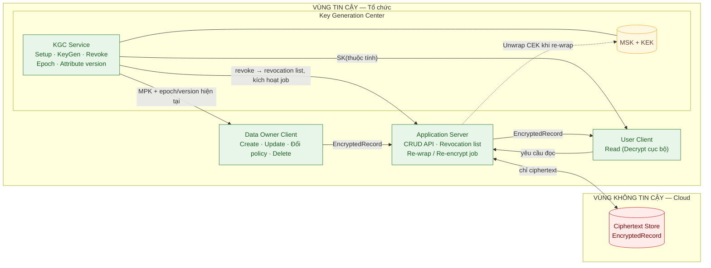
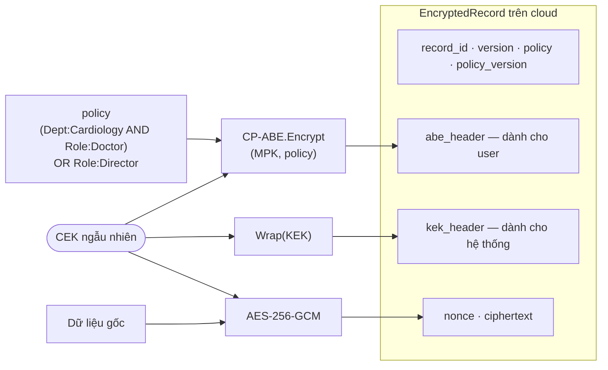
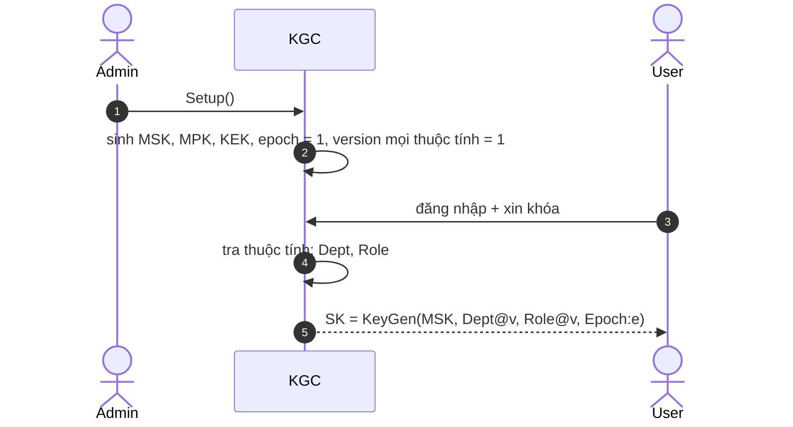
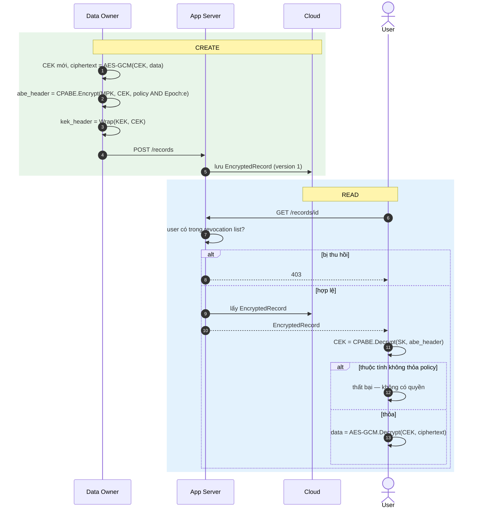
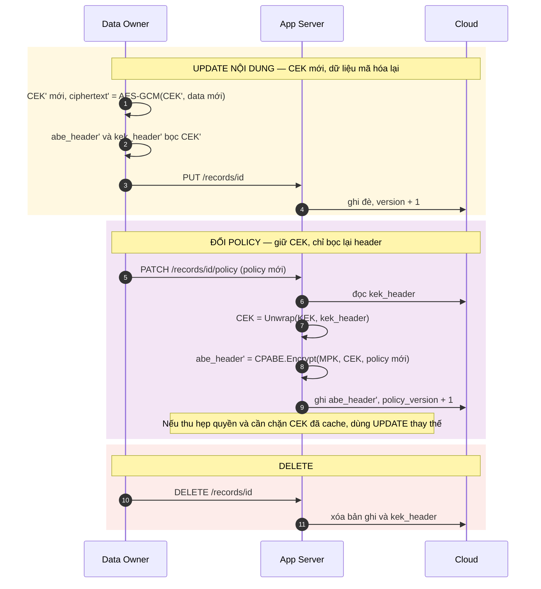
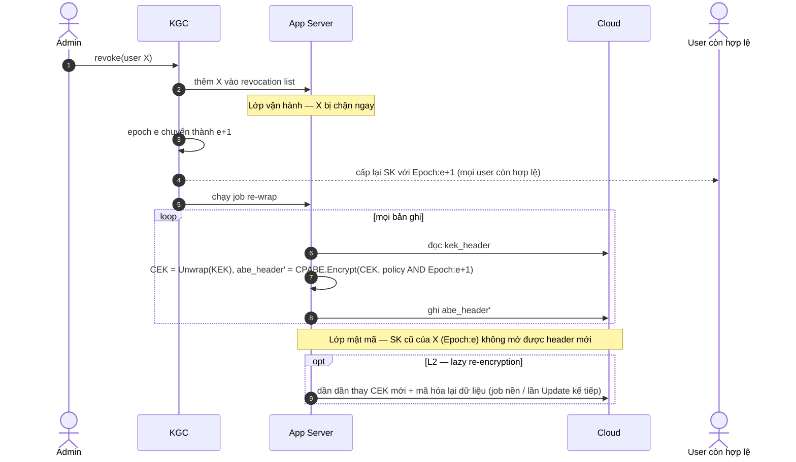
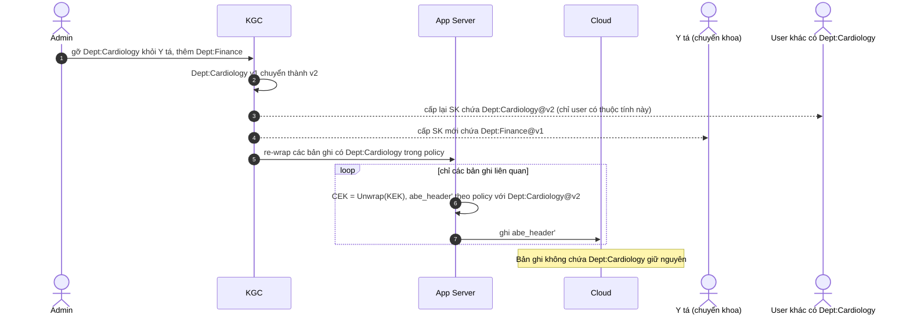
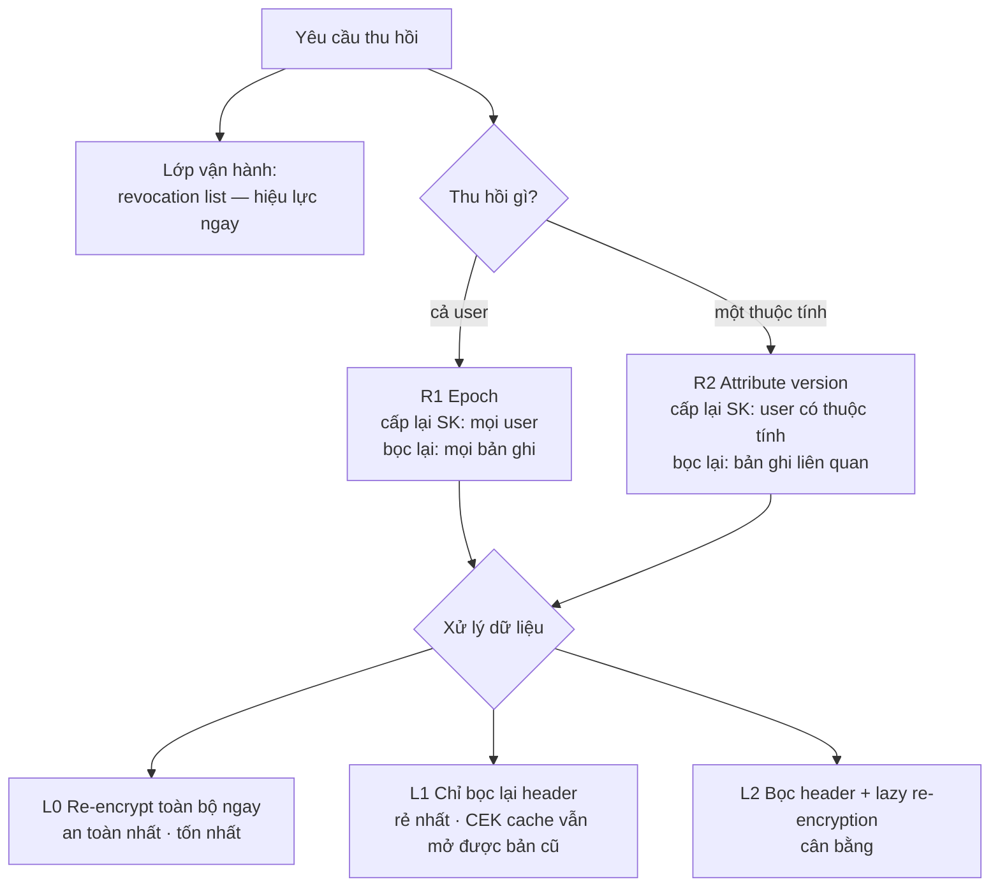

# Sơ đồ kiến trúc & luồng dữ liệu — CP-ABE: thao tác dữ liệu & thu hồi khóa

> Ứng với thiết kế **v3**: `analysis/02_ke-hoach-cai-thien-1-tuan.md`.
> Xem trong VS Code bằng extension *Markdown Preview Mermaid Support*, hoặc mở file `.html` cùng tên bằng trình duyệt. Muốn xuất PNG/SVG thì dán từng khối vào https://mermaid.live.

---

## 1. Kiến trúc tổng thể

---

## 2. Cấu trúc bản ghi mã hóa (mã hóa lai, CEK bọc kép)

---

## 3. Setup & cấp khóa

---

## 4. Create & Read

---

## 5. Update, Đổi policy, Delete

---

## 6. Thu hồi R1 — Epoch (thu hồi một user)

---

## 7. Thu hồi R2 — Attribute versioning (thu hồi một thuộc tính)

---

## 8. So sánh các chiến lược thu hồi (khung thí nghiệm RQ2)

