# Sơ đồ kiến trúc CP-ABE — v4.1 (làm rõ để triển khai)

> Đặc tả chi tiết (bảng thành phần, API, khóa, mô hình dữ liệu): `analysis/05_dac-ta-kien-truc-v4.1.md`.
> Thay đổi so với v4: xem `logs/design-changelog.md` (mục v4.1).
> Xem bằng trình duyệt: `v4-kien-truc-cp-abe.html`.

---

## 1. Ngữ cảnh hệ thống (C4 mức 1)

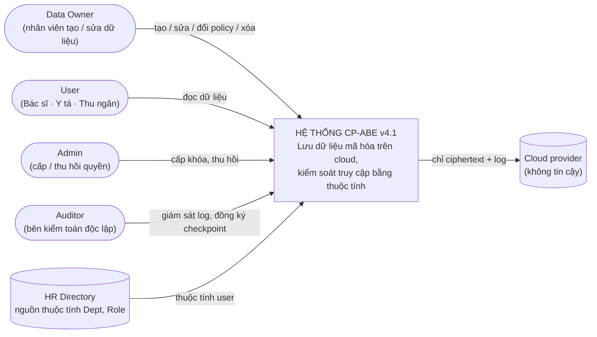

---

## 2. Container (C4 mức 2): ai chạy ở đâu

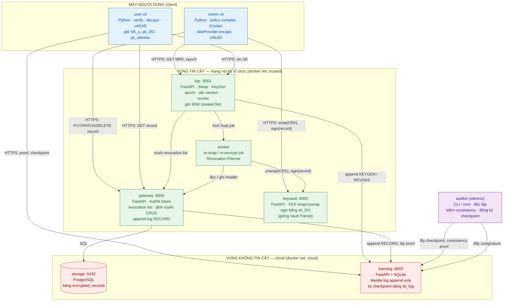

**Nguyên tắc phân tách:**
- `gateway` **không giữ khóa mật mã nào**, chỉ có token xác thực. Nhờ vậy, gateway bị lộ cũng không làm lộ dữ liệu.
- `keyvault` là nơi **duy nhất** chạm vào KEK và sk_DO. Mọi thao tác đi qua API và đều được ghi log.
- `kgc` là nơi **duy nhất** giữ MSK.
- `translog` đặt trên cloud. Nó không cần được tin cậy, vì checkpoint chỉ được chấp nhận khi có **chữ ký đồng thời của witness (auditor)**.

---

## 3. Bản đồ khóa và bí mật: khóa nào nằm ở đâu, ai được dùng

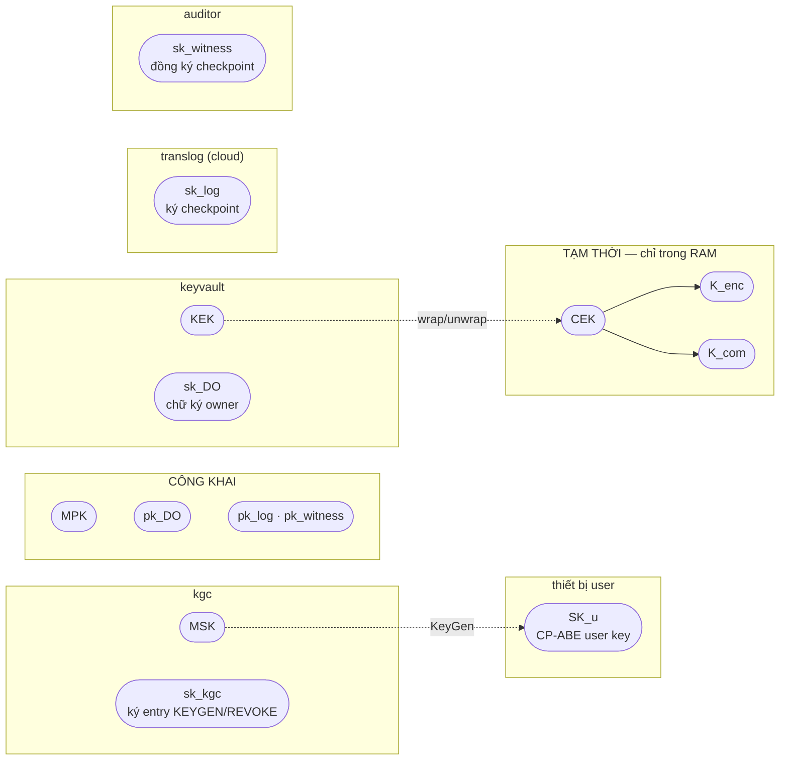

| Bí mật | Nơi lưu | Ai được dùng | Nếu bị lộ thì sao |
|---|---|---|---|
| MSK | kgc (file được seal) | Chỉ kgc | Giải mã được mọi thứ. Nhưng khóa cấp lén vẫn **bị log phát hiện** |
| KEK | keyvault | owner-cli (wrap), worker (unwrap) qua API | Lấy được mọi CEK. Mọi lần unwrap đều có log |
| sk_DO | keyvault | owner-cli, worker qua API `sign` | Giả mạo được bản ghi có chữ ký hợp lệ |
| SK_u | Thiết bị user | User | Lộ quyền của user đó. Xử lý bằng thu hồi |
| sk_log | translog | translog | Không đủ để giả checkpoint, vì còn thiếu chữ ký của witness |
| sk_witness | auditor | auditor | Cần đi cùng sk_log mới giả được checkpoint |
| CEK, K_enc, K_com | RAM | Phiên mã hóa / giải mã | Lộ đúng một bản ghi |

---

## 4. Triển khai (docker compose)

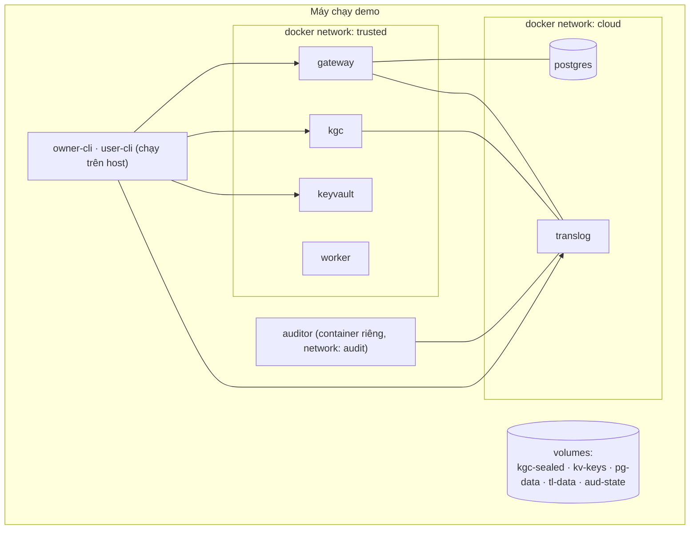

- Hai docker network `trusted` và `cloud` mô phỏng hai vùng tin cậy. Riêng `gateway` và `kgc` được nối vào cả hai network, vì chúng cần ghi xuống storage và log.
- Kịch bản tấn công "DBA của cloud" được chạy bằng `docker exec` vào container `postgres` / `translog`.

---

## 5. Transparency log: entry, checkpoint, witness

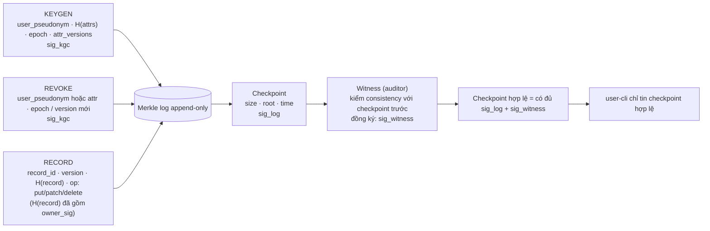

---

## 6. Luồng ghi (Create / Update)

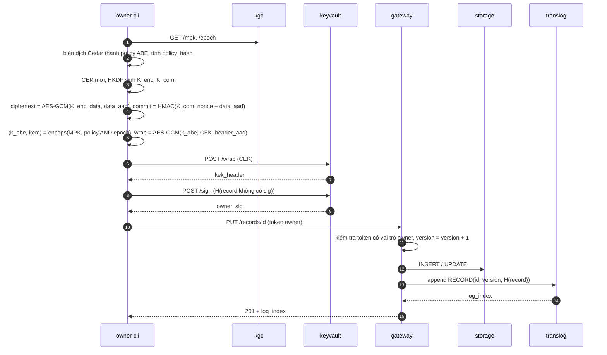

---

## 7. Luồng đọc

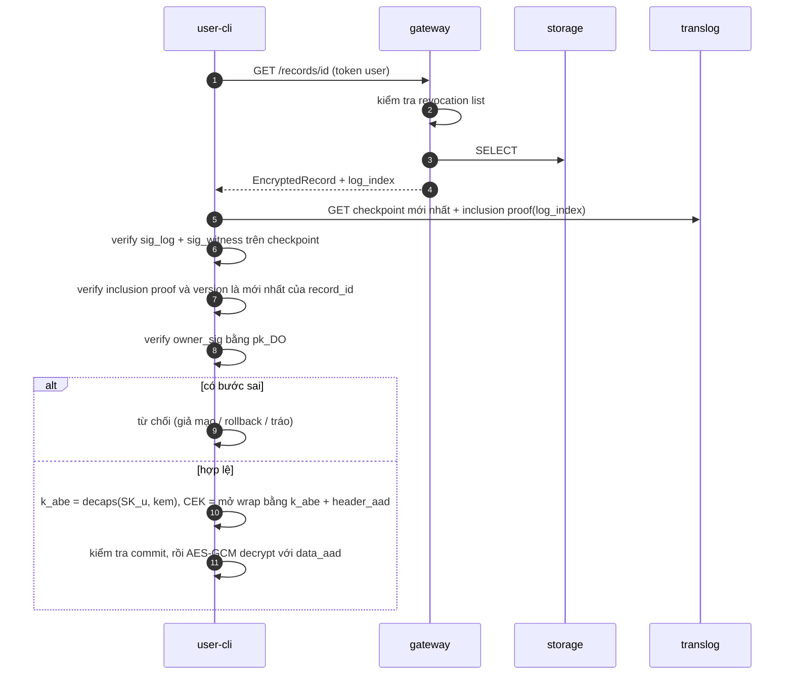

---

## 8. Luồng cấp khóa

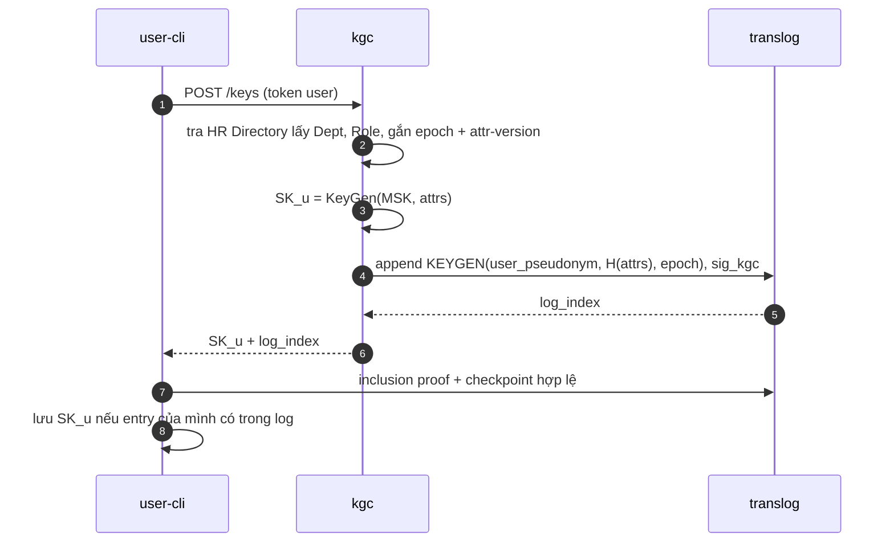

---

## 9. Luồng thu hồi

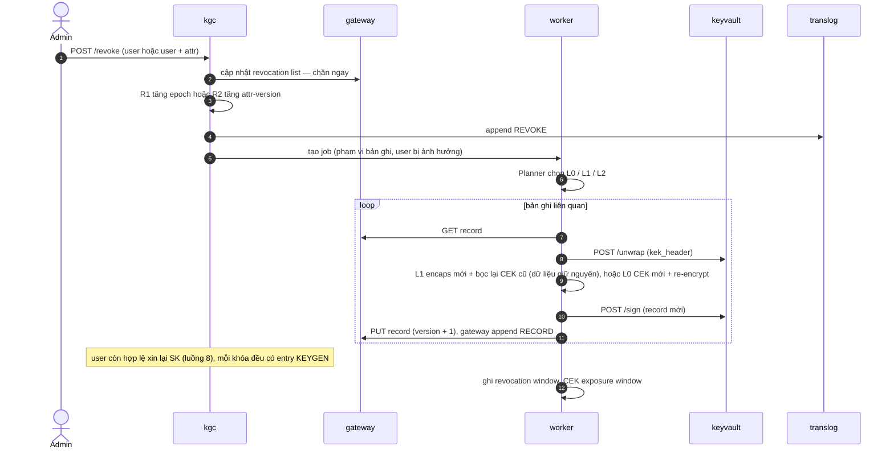

---

## 10. Cấu trúc EncryptedRecord (v4.2 — KEM 3 lớp)

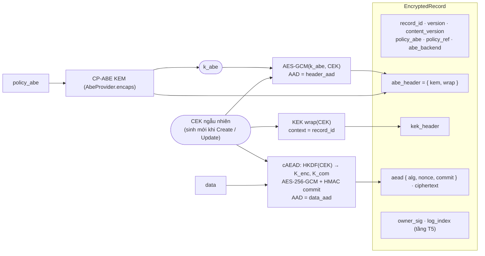

| Thao tác | abe_header | kek_header | ciphertext | version | content_version |
|---|---|---|---|---|---|
| Create | mới | mới | mới | 1 | 1 |
| Update nội dung | mới (CEK mới) | mới | mới | +1 | +1 |
| Đổi policy / thu hồi L1 | **mới** (CEK cũ) | giữ | **giữ** | +1 | giữ |
| Thu hồi L0 | mới (CEK mới) | mới | mới | +1 | +1 |

---

## 11. PoC phase 1 (v4.3): các docker image thực tế

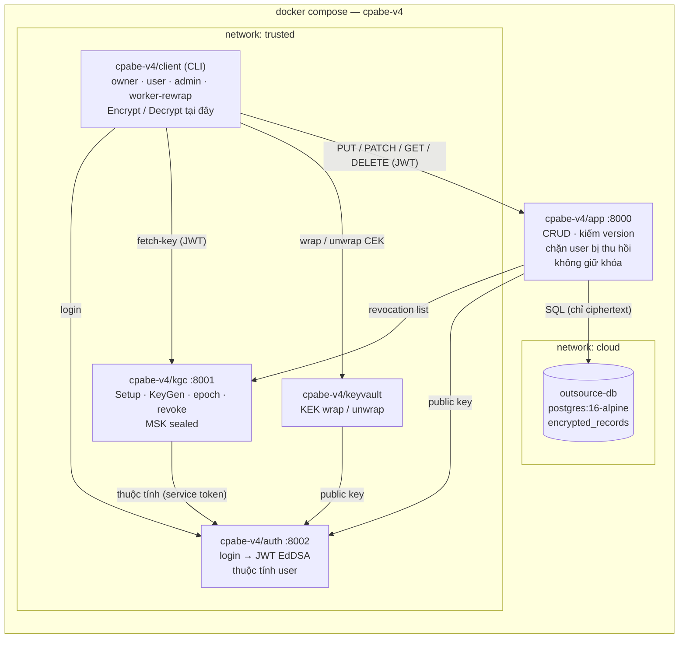
