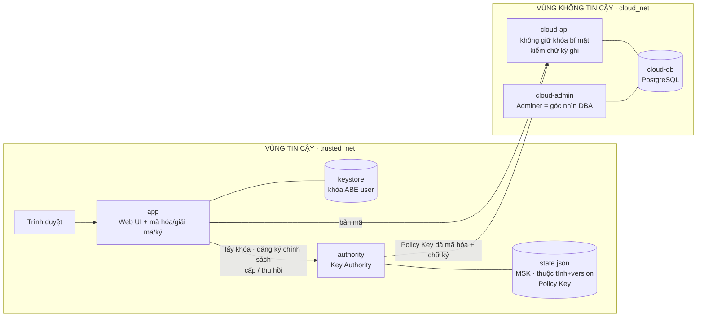
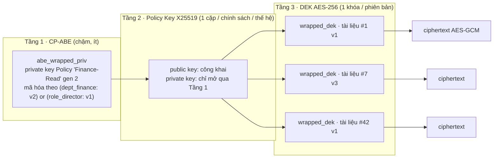
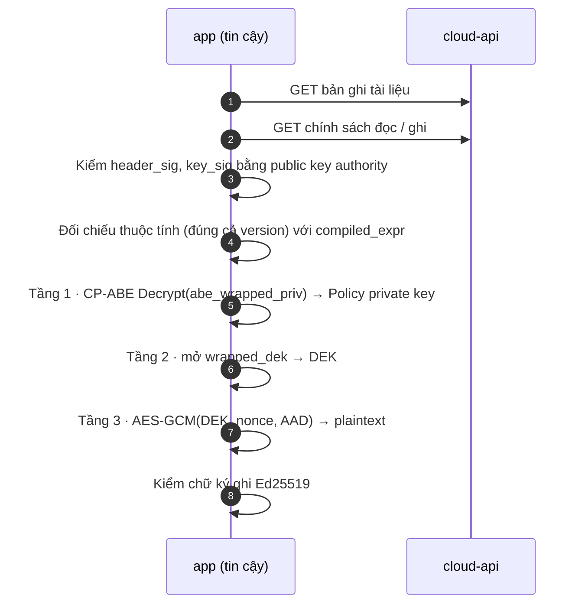
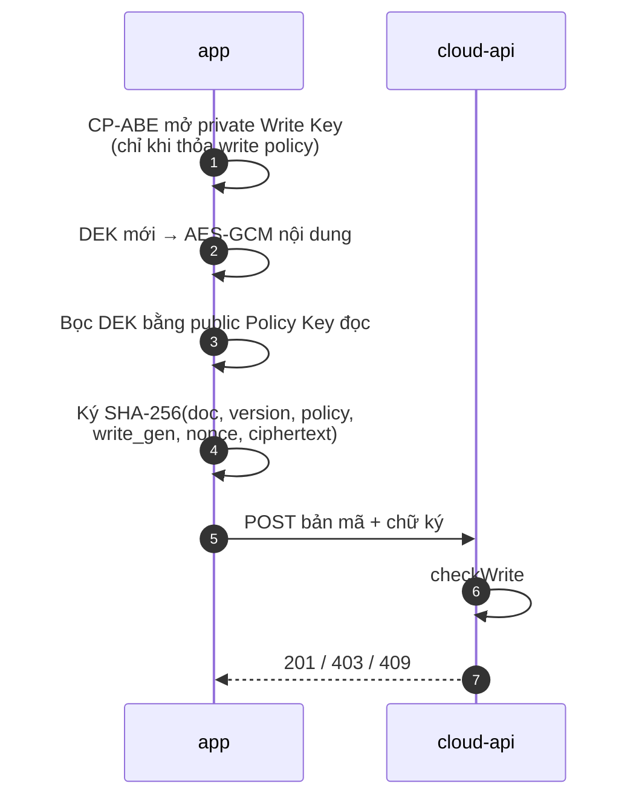
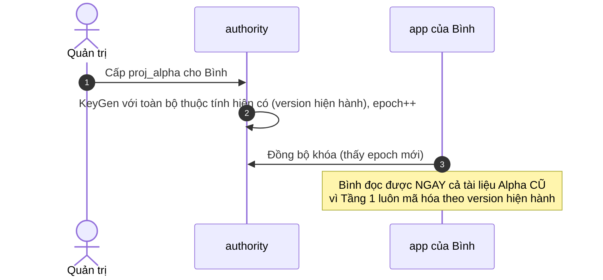
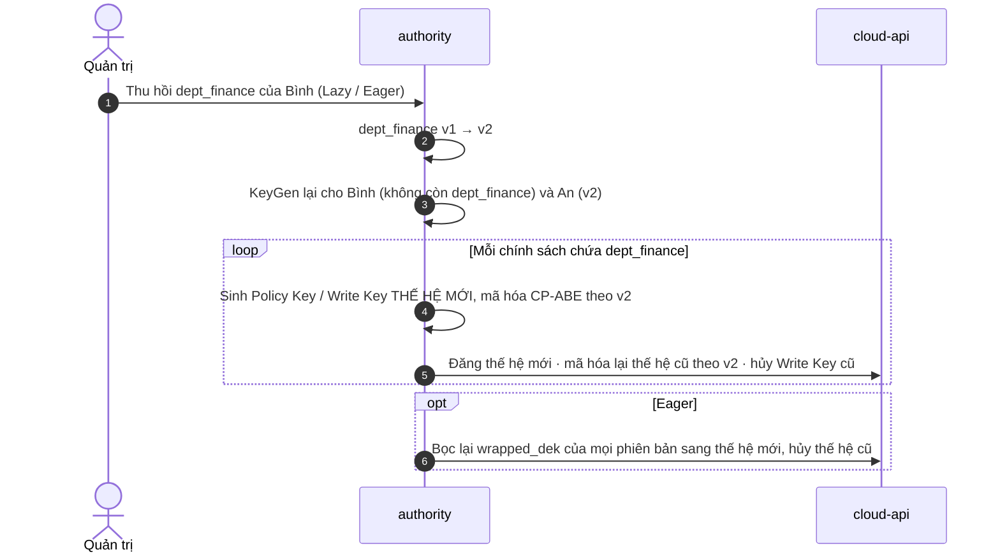

<div class="tiny">TRƯỜNG ĐẠI HỌC KHOA HỌC TỰ NHIÊN TP.HCM · KHOA CÔNG NGHỆ THÔNG TIN</div>

# Kiểm soát truy cập bằng CP-ABE<br>cho Outsourced Storage

<div style="font-size:1.1rem;color:#b5342b;margin:.4rem 0 1.4rem">Thiết kế cải tiến & hệ thống triển khai trên Docker</div>

<div class="small">

An toàn và bảo mật trong hệ thống thông tin · HP3-K35 · **Nhóm 06**

Nguyễn Võ Thiên Hà · Nguyễn Gia Hân · Trần Nhật Trường · Trương Trung Vĩnh

<span class="tiny">GVHD: PGS.TS. Đặng Trần Khánh · TG: TS. Phạm Thị Bạch Huệ · ThS. Lương Vĩ Minh</span>

</div>

---

# Nội dung

<div class="grid2" style="margin-top:1.2rem">
<div class="box"><b>1. Bài toán & hướng tiếp cận</b><br><span class="small">Vì sao cần CP-ABE · threat model</span></div>
<div class="box"><b>2. Cải tiến so với đề xuất ban đầu</b><br><span class="small">6 cải tiến C1–C6, nguồn trong 5 năm gần đây</span></div>
<div class="box"><b>3. Kiến trúc & cấu trúc dữ liệu</b><br><span class="small">Container, vùng tin cậy, phân cấp khóa 3 tầng</span></div>
<div class="box"><b>4. Luồng xử lý</b><br><span class="small">Đọc · Viết · Sửa · Cấp / Thu hồi thuộc tính</span></div>
<div class="box"><b>5. Demo & kết quả kiểm thử</b><br><span class="small">10 kịch bản, số liệu đo thực tế</span></div>
<div class="box"><b>6. Hạn chế & hướng phát triển</b></div>
</div>

---

### 1 · Bài toán

# Dữ liệu trên cloud: ai thực sự kiểm soát?

<div class="grid2" style="margin-top:.6rem">
<div>

- Phân quyền DBMS, mã hóa TDE, kiểm soát ở tầng ứng dụng: **đều giả định môi trường vận hành đáng tin**
- Khi outsource, nhà cung cấp cloud có toàn quyền admin: đọc file dữ liệu, nắm khóa TDE, đọc bản sao lưu
- Doanh nghiệp vẫn cần **nhiều người viết, nhiều người đọc**, quyền thay đổi theo thời gian (chuyển phòng, thêm dự án)

</div>
<div class="box green">

**Hướng đi**

Gắn quyền truy cập **vào chính phép mã hóa**.<br>
Cloud chỉ giữ bản mã; không có khóa mang **thuộc tính phù hợp** thì dữ liệu vô nghĩa.

**CP-ABE**: bản mã gắn *chính sách*, khóa người dùng gắn *thuộc tính*. Giải mã được khi thuộc tính thỏa chính sách.

</div>
</div>


<!--
Nhấn mạnh: mọi lớp bảo vệ truyền thống đều nằm trên hạ tầng do cloud quản trị. CP-ABE chuyển việc thực thi quyền sang phép mã hóa ở phía tổ chức.
-->

---

### 1 · Threat model

# Ai tin cậy, ai không

<div class="grid2">
<div class="box red">

**KHÔNG TIN CẬY: Cloud** (honest-but-curious)

- Làm đúng giao thức nhưng tò mò đọc dữ liệu
- DBA xem được mọi bảng, mọi bản sao lưu
- *(mở rộng)* cloud độc hại sửa dữ liệu → **bị phát hiện**

</div>
<div class="box green">

**TIN CẬY: Doanh nghiệp**

- **Key Authority**: giữ Master Key, cấp/thu hồi thuộc tính
- **App** của người dùng: mã hóa / giải mã / ký tại chỗ

</div>
</div>

| | Đề xuất ban đầu | Hiện tại |
|---|---|---|
| Confidentiality | ✔ | ✔ |
| Integrity | ✖ ngoài phạm vi | ✔ **một phần**: chữ ký ghi + AES-GCM |
| Collusion (gộp khóa) | "ngoài phạm vi" | ✔ **CP-ABE chống sẵn** |
| Key Authority bị xâm nhập · Availability · Rollback | ngoài phạm vi | ngoài phạm vi |

---

### 2 · Cải tiến

# 6 cải tiến so với đề xuất ban đầu

| # | Hạn chế ban đầu | Cải tiến | Nguồn |
|---|---|---|---|
| **C1** | BSW07 (2007), chỉ AND/OR, an toàn CPA | Lược đồ **TKN20** qua thư viện **Cloudflare CIRCL** | PKC 2020 · triển khai thật ở Cloudflare 2023 |
| **C2** | Mỗi tài liệu 1 bản mã CP-ABE → thu hồi tốn kém | **Phân cấp khóa 3 tầng** (Policy Key) | Cloudflare Geo Key Manager v2 (2023) |
| **C3** | Chỉ có quyền đọc, ai cũng ghi đè được | **Tách quyền Đọc / Ghi** bằng chữ ký, cloud kiểm trước khi nhận | mở rộng C2 cho chữ ký |
| **C4** | Thu hồi mới liệt kê, chưa có luồng | **Version thuộc tính + thế hệ khóa**, Lazy / Eager | kết hợp C1 + C2 |
| **C5** | Policy lộ thông tin nghiệp vụ | Ẩn tên thuộc tính *(thiết kế, chưa bật)* | — |
| **C6** | Bệnh viện, một người ghi | **Doanh nghiệp, nhiều người ghi/đọc**, phiên bản | — |

<div class="tiny" style="margin-top:.6rem">Chuẩn hóa: ETSI TS 103 532 V1.2.1 (05/2021): ABE for Attribute-Based Access Control</div>


<!--
Đi nhanh qua bảng; mỗi cải tiến có slide riêng phía sau. Tính mới: Cloudflare triển khai CP-ABE thật năm 2023; ETSI chuẩn hóa 2021.
-->

---

### 2 · Use case

# Công ty ABC: kho tài liệu nội bộ trên cloud

<div class="grid2">
<div>

| Người dùng | Thuộc tính |
|---|---|
| An | `dept_finance` `role_manager` |
| Bình | `dept_finance` `role_staff` |
| Chi | `dept_hr` `role_manager` |
| Dũng | `dept_eng` `role_staff` `proj_alpha` |
| Hà | `role_director` |

</div>
<div>

| Tài liệu | Ai được ĐỌC | Ai được SỬA |
|---|---|---|
| Bảng lương | `(dept_hr and role_manager) or role_director` | `dept_hr and role_manager` |
| Báo cáo Q3 | `dept_finance or role_director` | `dept_finance and role_manager` |
| Dự án Alpha | `proj_alpha or role_director` | `proj_alpha` |
| Đề xuất ngân sách | `dept_finance and role_manager` | `role_staff or role_manager` |

</div>
</div>

> Mỗi tài liệu có **2 chính sách**. Dòng cuối là **ghi mà không đọc**: nhân viên nộp đề xuất nhưng không xem được đề xuất của người khác.
> Use case: **Viết · Đọc · Sửa · Cấp thuộc tính · Thu hồi thuộc tính** (không thu hồi tài khoản, không đăng nhập).

---

### 3 · Kiến trúc

# Kiến trúc triển khai: 5 container, 2 vùng



<div class="small">

`cloud-api` chỉ nằm trong `cloud_net`, nên **không gọi được** `authority`: Docker network thể hiện trực tiếp ranh giới tin cậy.

</div>


<!--
Chỉ vào 2 docker network: cloud-api không có đường tới authority. Plaintext chỉ tồn tại trong app.
-->

---

### 3 · Thành phần

# Vai trò từng container

| Container | Vùng | Giữ gì | Làm gì |
|---|---|---|---|
| `authority` | Tin cậy | Master Secret Key, thuộc tính + **version**, private key của Policy Key | Setup, KeyGen, đăng ký & **biên dịch** chính sách, cấp / thu hồi, Eager re-wrap |
| `app` | Tin cậy | Khóa ABE của user (mọi epoch) | Web UI. **Mã hóa / giải mã / ký tại chỗ**, plaintext không rời app |
| `cloud-api` | Cloud | **Không có khóa bí mật** | Lưu bản mã, kiểm chữ ký bằng public key, kiểm số phiên bản (409) |
| `cloud-db` | Cloud | Bản mã, public key, Policy Key đã mã hóa CP-ABE | PostgreSQL 16 |
| `cloud-admin` | Cloud | — | Adminer: minh họa DBA tò mò |

<div class="grid3" style="margin-top:.8rem">
<div class="box small"><b>Ngôn ngữ</b><br>Go 1.26, 1 module, 1 image cho 3 service</div>
<div class="box small"><b>Thư viện</b><br>CIRCL v1.6.5 (CP-ABE) · x/crypto (X25519) · pgx v5</div>
<div class="box small"><b>Chạy</b><br><code>cd code && docker compose up -d --build</code></div>
</div>

---

### 3 · Mã nguồn

# Cấu trúc thư mục

<div class="grid2">
<div>

```text
CP_ABE_1/
├── code/
│   ├── docker-compose.yml
│   ├── Dockerfile
│   ├── shared/      # dùng chung
│   │   ├── abe.go        CP-ABE (CIRCL tkn20)
│   │   ├── crypto.go     X25519 · AES-GCM · Ed25519
│   │   ├── types.go      bản ghi, chữ ký
│   │   └── cloudclient.go / authapi.go
│   ├── authority/
│   │   ├── policy.go     biên dịch version, thế hệ
│   │   └── main.go       grant / revoke / eager
│   ├── cloudapi/main.go  REST + checkWrite
│   └── app/
│       ├── vault.go      quy trình ĐỌC
│       ├── write.go      quy trình xét quyền SỬA / GHI
│       └── templates/    UI
├── docs/  ref/  slides/
└── CHANGELOG.md
```

</div>
<div class="small">

**Nguyên tắc tổ chức**

- `shared` chứa **toàn bộ mật mã**: 3 service dùng chung một cài đặt
- `authority` là nơi **duy nhất** chạm Master Key
- `cloudapi` chỉ import phần *kiểm* chữ ký, không có hàm giải mã nào
- `app` ghi lại **từng bước** đọc/ghi để hiển thị "bản thô" trên UI

**Quy trình làm việc**

- Mọi nguồn tham khảo: `docs/research/sources.md` (có mức kiểm chứng)
- Mọi thay đổi: `CHANGELOG.md` + git commit

</div>
</div>

---

### C1 · Lược đồ CP-ABE

# TKN20 qua thư viện Cloudflare CIRCL

<div class="grid2">
<div>

**Vì sao thay BSW07?**

- Hỗ trợ `and`, `or`, `not`; chính sách viết dạng chữ
- Có biến thể **an toàn CCA** (BSW07 gốc chỉ CPA)
- Thuộc tính dạng **tên: giá trị**, rất hợp để gắn **version**
- Đã chạy thật: **Cloudflare Geo Key Manager v2 (2023)**
- Go thuần, cài bằng 1 lệnh; Charm-crypto rất khó cài trên Python mới

</div>
<div>

**Chỉ dùng 5 hàm**

| Việc | Hàm |
|---|---|
| Khởi tạo | `tkn20.Setup` |
| Cấp khóa | `msk.KeyGen(attrs)` |
| Mã hóa | `pk.Encrypt(policy, msg)` |
| Giải mã | `key.Decrypt(ct)` |
| Kiểm nhanh | `attrs.CouldDecrypt(ct)` |

```text
(dept_finance: v2) or (role_director: v1)
```

<span class="tiny">Không dùng <code>not</code>: xung đột với cơ chế version khi thu hồi.</span>

</div>
</div>

---

### C2 · Phân cấp khóa

# 3 tầng khóa: CP-ABE chỉ bảo vệ **1 khóa / chính sách**



<div class="grid3 small">
<div class="box green"><b>Thu hồi rẻ</b><br>Chỉ xử lý lại Tầng 1 của các <i>chính sách</i> liên quan, không đụng hàng nghìn <i>tài liệu</i></div>
<div class="box blue"><b>Ghi mà không đọc</b><br>Ai cũng bọc DEK bằng <i>public</i> key; chỉ người thỏa chính sách mở được</div>
<div class="box"><b>Nhanh</b><br>Giải mã CP-ABE 1 lần / chính sách, sau đó dùng cache</div>
</div>


<!--
Ý chính của C2: CP-ABE đắt (bản mã ~2,7 KB, giải mã chậm) nên chỉ dùng cho số ít khóa chính sách. Hàng nghìn tài liệu dùng AES nhanh.
-->

---

### 3 · Cấu trúc dữ liệu

# Cloud lưu gì? (toàn bộ là bản mã hoặc định danh)

<div class="grid2">
<div>

**`document_versions`**: 1 dòng / phiên bản

| Trường | Ý nghĩa |
|---|---|
| `doc_id`, `version` | mã ngẫu nhiên, số phiên bản |
| `read_policy_id`, `read_gen` | chính sách đọc + thế hệ Policy Key |
| `wrapped_dek` | DEK bọc bằng public Policy Key (80 B) |
| `nonce`, `ciphertext` | nội dung AES-256-GCM |
| `write_policy_id`, `write_gen` | chính sách ghi + thế hệ Write Key |
| `signature` | Ed25519 (64 B) |

</div>
<div>

**`policies`** + **`policy_keys`**: 1 dòng / thế hệ

| Trường | Ý nghĩa |
|---|---|
| `logical_expr` | `dept_finance or role_director` |
| `compiled_expr` | `(dept_finance: v2) or (role_director: v1)` |
| `current_gen` | thế hệ dùng cho ghi mới |
| `public_key` | X25519 (đọc) / Ed25519 (ghi) |
| `abe_wrapped_priv` | private key, **mã hóa CP-ABE** (~2,7 KB) |
| `header_sig`, `key_sig` | chữ ký **authority**: cloud không tráo khóa được |

</div>
</div>

---

### 4 · Luồng ĐỌC

# Đọc tài liệu: 7 bước, chạy hoàn toàn trong app



<div class="small">Thất bại ở bước nào thì UI hiển thị đúng bước đó (🔒 thiếu thuộc tính · khóa version cũ · bản mã bị sửa). Mọi giá trị hex được hiện đầy đủ.</div>

---

### C3 · Tách quyền Đọc / Ghi

# Luồng GHI: cloud kiểm quyền mà không cần khóa bí mật

<div class="grid2">
<div>



</div>
<div class="small">

**Cloud kiểm (`checkWrite`)**

1. `version` = mới nhất + 1 → nếu không: **409**
2. Chính sách đọc/ghi giữ nguyên
3. `write_gen` = thế hệ hiện hành → nếu không: **403**
4. Chữ ký hợp lệ với public Write Key → nếu không: **403**

| Ai | Kết quả |
|---|---|
| Thỏa write policy | ✔ tạo phiên bản mới |
| Chỉ thỏa read policy | ✖ cloud trả 403 |
| Cloud tự sửa bản mã | ✖ người đọc phát hiện |

</div>
</div>


<!--
Cloud honest-but-curious vẫn làm đúng giao thức: kiểm chữ ký. Nếu cloud độc hại bỏ qua kiểm tra, người đọc vẫn phát hiện qua chữ ký.
-->

---

### C4 · Version thuộc tính

# Chính sách logic → chính sách thật

<div class="grid2">
<div>

Người dùng viết chính sách **logic**:

```text
dept_finance or role_director
```

`authority` **biên dịch** với version hiện hành:

```text
(dept_finance: v2) or (role_director: v1)
```

Khóa của user chứa thuộc tính **kèm version**:

```text
An   → { dept_finance: v2, role_manager: v1 }
Bình → { role_staff: v1 }          (đã bị thu hồi)
Bình, khóa cũ → { dept_finance: v1, ... }  ✖ không khớp v2
```

</div>
<div class="small">

| Khái niệm | Tăng khi |
|---|---|
| **version** thuộc tính (`v1`, `v2`) | thu hồi thuộc tính đó của ai đó |
| **thế hệ** (gen) của chính sách | chính sách chứa thuộc tính vừa bị thu hồi |
| **epoch** khóa user | user được cấp lại khóa |

> Version nằm trong **giá trị** của cặp *tên: giá trị* mà CIRCL hỗ trợ sẵn → **không phải sửa toán học** của lược đồ.

</div>
</div>

---

### 4 · Cấp thuộc tính

# Cấp thêm thuộc tính: 1 lần KeyGen, không mã hóa lại gì



<div class="box green small" style="margin-top:.6rem">

Khác với hệ thống dùng *khóa nhóm*: người mới vào nhóm **không cần** ai mã hóa lại tài liệu cũ cho họ.

</div>

---

### 4 · Thu hồi thuộc tính

# Thu hồi `dept_finance` của Bình (tài khoản vẫn còn)



<div class="grid3 small">
<div class="box"><b>Đọc bản mới?</b> <span class="bad">Không</span>: DEK bọc bằng thế hệ mới</div>
<div class="box"><b>Sửa?</b> <span class="bad">Không, ngay lập tức</span>: cloud chỉ nhận Write Key hiện hành</div>
<div class="box"><b>Khóa cũ (v1)?</b> <span class="bad">Không</span>: mọi bản mã CP-ABE đã sang v2</div>
</div>


<!--
Demo kịch bản C và H ngay sau slide này: thu hồi, rồi đóng vai Bình với khóa epoch cũ, mở bước 3 của quy trình giải mã để thấy v1 ≠ v2.
-->

---

### C4 · Lazy & Eager

# Hai chế độ xử lý tài liệu cũ

| Chế độ | Làm gì | Ưu | Nhược |
|---|---|---|---|
| **Lazy** (mặc định) | Không đụng tài liệu cũ; lần **sửa** tiếp theo tự dùng DEK mới + thế hệ mới | Gần như không tốn chi phí | Phiên bản cũ vẫn bọc bằng thế hệ cũ (đã mã hóa lại theo v2) |
| **Eager** | Bọc lại `wrapped_dek` của **mọi phiên bản** sang thế hệ mới, hủy thế hệ cũ | Đóng rủi ro "lưu lén private Policy Key cũ" | Tỉ lệ với số phiên bản (nhưng **không** mã hóa lại nội dung) |

### So sánh chi phí khi thu hồi 1 thuộc tính (trả lời RQ2)

| Thao tác | Thiết kế ban đầu | Thiết kế hiện tại |
|---|---|---|
| Mã hóa CP-ABE lại | = số **tài liệu** chứa thuộc tính | = số **chính sách** chứa thuộc tính × số thế hệ |
| Mã hóa lại nội dung | Có | **Không** (Lazy & Eager) |
| Cấp lại khóa user | = số user giữ thuộc tính | = số user giữ thuộc tính |
| Thu hồi quyền ghi | không có cơ chế | **hiệu lực ngay** |

---

### 5 · Demo

# Giao diện: chọn vai, xem "bản thô" từng bước

<div class="grid2">
<div class="small">

| Tab | Nội dung |
|---|---|
| **Kho tài liệu** | 🔓 / 🔒 theo khóa của người đang đóng vai, Xem · Sửa |
| **Tài liệu** | Nội dung + **quy trình giải mã 7 bước** (hex đầy đủ) + lịch sử phiên bản |
| **Sửa** | **Quy trình xét quyền sửa**, sau khi lưu là **quy trình ghi** (201/403/409) |
| **Quản trị thuộc tính** | Ma trận user × thuộc tính, Cấp / Thu hồi, Lazy / Eager, nhật ký |
| **Góc nhìn Cloud** | Đúng những gì cloud lưu, nút "sửa 1 bit" |
| **Thuật ngữ** | `wrapped_dek`, `abe_wrapped_priv`… |

</div>
<div class="small">

**Không có đăng nhập**: ô *"Đang đóng vai"* + ô chọn *epoch khóa* (để thử khóa cũ).

**URL**

- App: `http://localhost:8088`
- Adminer (DBA cloud): `http://localhost:8090`

> Mỗi bước hiển thị: dữ liệu lấy **từ đâu**, chạy **ở đâu**, đầu vào / đầu ra, thời gian.

</div>
</div>


<!--
Chuyển sang trình duyệt. Thứ tự demo gợi ý: A → B → I → D → C → H → F → E → J.
-->

---

### 5 · Kịch bản

# Kịch bản kiểm chứng

| # | Kịch bản | Kết quả |
|---|---|---|
| A | DBA cloud mở DB | Chỉ thấy byte mã hóa |
| B | Dũng mở Bảng lương | 🔒 thiếu thuộc tính, hiện chính sách cần có |
| C | Thu hồi `dept_finance` của Bình | Bình không đọc được tài liệu Tài chính; An không bị ảnh hưởng |
| D | Bình ghi trái phép (khóa tự tạo) | Cloud **403** |
| E | Cloud sửa 1 bit bản mã | App báo AES-GCM / chữ ký không hợp lệ |
| F | Cấp `proj_alpha` cho Bình | Đọc ngay tài liệu Alpha cũ |
| G | Bình + Chi (collusion) | Không ai mở được tài liệu cần `dept_finance and role_manager` |
| H | Bình dùng **khóa cũ** sau thu hồi | 🔒: `dept_finance: v1` ≠ `v2` |
| I | Dũng sửa Đề xuất ngân sách | **Ghi được, không đọc được** |
| J | Thu hồi chế độ Eager | Mọi phiên bản sang thế hệ mới, thế hệ cũ "đã hủy" |

---

### 5 · Kết quả

# Kết quả chạy thử trên Docker

<div class="grid2">
<div class="small">

| Kiểm thử | Kết quả |
|---|---|
| Quyền đọc/sửa của 5 user | <span class="ok">đúng bảng chính sách</span> |
| Ghi trái phép · sửa trùng phiên bản | <span class="ok">403 · 409</span> |
| Thu hồi Lazy · Bình dùng khóa cũ | <span class="ok">đọc 0 tài liệu Tài chính</span> |
| Cấp thuộc tính | <span class="ok">đọc ngay tài liệu cũ</span> |
| Cloud sửa 1 bit | <span class="ok">phát hiện</span> |
| Eager | <span class="ok">bọc lại DEK, hủy thế hệ cũ</span> |

</div>
<div class="small">

**Số đo** (1 lần chạy, máy demo 1 vCPU)

| Thao tác | Thời gian |
|---|---|
| Thu hồi Lazy: 2 KeyGen + 3 chính sách sang thế hệ mới | **~0,66 s** |
| Thu hồi Eager: 2 KeyGen + 2 chính sách + bọc lại 1 phiên bản | **~0,26 s** |
| Bản mã CP-ABE của 1 private key | **~2,7 KB** |

<span class="tiny">Số liệu chỉ để minh họa quy mô; đo có hệ thống (theo số thuộc tính, số tài liệu) là bước tiếp theo (RQ3).</span>

</div>
</div>

---

### 6 · Hạn chế

# Hạn chế & hướng phát triển

<div class="grid2 small">
<div>

| Hạn chế hiện tại | Hướng xử lý |
|---|---|
| Key Authority là điểm tin cậy duy nhất | Multi-Authority CP-ABE |
| Chưa đổi được chính sách của tài liệu đã có | Ký bằng Write Key **cũ** + cloud kiểm |
| Tên thuộc tính lộ trên cloud | C5: bí danh thuộc tính; xa hơn là policy-hiding |
| Rollback (cloud trả phiên bản cũ) | Log công khai / transparency log |
| Giải mã trên server app | Giải mã ngay trên trình duyệt (WebAssembly) |
| Chưa tìm kiếm trên dữ liệu mã hóa | Searchable Encryption |

</div>
<div>

**Không làm (và vì sao)**

- *Proxy re-encryption phía cloud*: phải sửa toán của lược đồ; C2 + C4 đạt mục tiêu tương tự ở tầng hệ thống
- *Outsourced decryption*: nhờ C2, CP-ABE chỉ giải mã 1 lần / chính sách nên lợi ích nhỏ

</div>
</div>

---

# Tài liệu tham khảo

<div class="small">

**Trong 5 năm gần đây**

1. Cloudflare, *Inside Geo Key Manager v2: re-imagining access control for distributed systems*, 27/01/2023
2. Cloudflare, *Portunus*: RBAC xây trên CP-ABE, Real World Crypto 2023
3. Cloudflare CIRCL, gói `abe/cpabe/tkn20`, v1.6.5
4. ETSI TS 103 532 V1.2.1 (2021-05), *Attribute Based Encryption for Attribute Based Access Control*
5. Penuelas-Angulo, Feregrino-Uribe, Morales-Sandoval, *Revocation in ABE for fog-enabled IoT: A systematic survey*, Internet of Things vol. 23, 2023

**Nền tảng**

6. Tomida, Kawahara, Nishimaki: lược đồ TKN20, PKC 2020
7. Bethencourt, Sahai, Waters, *Ciphertext-Policy Attribute-Based Encryption*, IEEE S&P 2007
8. Kallahalla et al., *Plutus: Scalable Secure File Sharing on Untrusted Storage*, FAST 2003
9. Zhao et al., 2011: CP-ABE + chữ ký thuộc tính cho quyền đọc/ghi

</div>

<div class="tiny">Chi tiết và mức độ kiểm chứng từng nguồn: docs/research/sources.md</div>

---
layout: center
class: text-center
---

# Cảm ơn thầy cô và các bạn đã lắng nghe

<div style="font-size:1.6rem;color:#b5342b;margin-top:1rem">Q & A</div>

<div class="tiny" style="margin-top:2rem">Nhóm 06 · Kiểm soát truy cập bằng CP-ABE cho Outsourced Storage</div>
